<picture>
  <source media="(prefers-color-scheme: dark)" srcset="banner-dark.svg">
  
</picture>

 

I build data products end to end. On the backend: pipelines, indexers, warehouses and the infrastructure they run on. In the middle: data models and APIs that make it all queryable. On the front: dashboards and web apps people actually use. And then the analytics itself, from product metrics and cohorts to graph analysis and simulations of complex systems.

 

<table>
<tr>
<td valign="top">
 

**◆ &nbsp;Data infrastructure**

[`dbt-cerebro`](https://github.com/gnosischain/dbt-cerebro) 
Semantic models over raw execution, consensus and P2P data

[`cryo-indexer`](https://github.com/gnosischain/cryo-indexer) · [`beacon-indexer`](https://github.com/gnosischain/beacon-indexer) 
Execution and consensus layer data into ClickHouse

[`clickhouse-benchmark`](https://github.com/hdser/clickhouse-benchmark) 
Latency and memory profiling for analytical workloads

</td>
<td valign="top">
 

**◆ &nbsp;APIs, dashboards & AI**

[`metrics-dashboard`](https://github.com/gnosischain/metrics-dashboard) 
Analytics front end for product and infrastructure teams

[`cerebro-api`](https://github.com/gnosischain/cerebro-api) 
REST endpoints auto-generated from dbt models, with auth and rate limits

[`cerebro-mcp`](https://github.com/gnosischain/cerebro-mcp) 
MCP server for AI agents: SQL, dbt lineage, charts and reports

</td>
</tr>
<tr>
<td valign="top">

**◆ &nbsp;Graphs & trust networks**

[`graph_analyzer`](https://github.com/hdser/graph_analyzer) 
120+ network metrics with a FastAPI web viewer

[`trust-score`](https://github.com/hdser/trust-score) 
EigenTrust, Appleseed and PageRank-style scoring

[`pyfinder`](https://github.com/hdser/pyfinder) 
Max-flow routing of value over trust networks

</td>
<td valign="top">

**◆ &nbsp;Simulation & modeling**

[`circlesubi-simulation`](https://github.com/hdser/circlesubi-simulation) 
Agent-based model of UBI with interactive dashboards

[`PyCircleSim`](https://github.com/hdser/PyCircleSim) 
Network evolution and value-flow simulation

[`pathfinder2`](https://github.com/hdser/pathfinder2) 
Rust pathfinding engine and methodology docs

</td>
</tr>
<tr>
<td colspan="2" valign="top">

**◆ &nbsp;Open source** &nbsp;·&nbsp; [`spellbook`](https://github.com/duneanalytics/spellbook) shared on-chain SQL models on Dune &nbsp;·&nbsp; [`circles-nethermind-plugin`](https://github.com/aboutcircles/circles-nethermind-plugin) node-level data for Circles

</td>
</tr>
</table>

 

→ more on [dune.com/hdser](https://dune.com/hdser)
